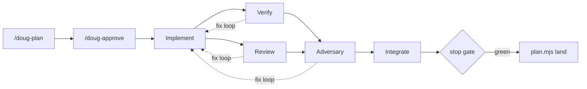

# Doug

[](https://github.com/eschwa3/dougharness/actions/workflows/ci.yml)
[](https://www.npmjs.com/package/@dougharness/cli)

Plan, approve, run, gate: guardrails for Claude Code that check the agent's work instead of trusting its word.

Left alone, an agent drifts from the spec, skips the tests it should have run, and reports "done" on work that isn't. Doug's plan is written first, deterministic hooks (small scripts Claude Code runs automatically around every action) block on broken or untested work, and a second model argues against the first before anything lands.



## Why Doug

- **Gates an agent cannot talk past.** Hooks run outside the model: the stop gate blocks a turn while typecheck or tests fail, for up to 3 blocks in a row, then stands down and says so, and fails open on its own crash or timeout; `.env` files, the lockfile, migrations, and anything outside the project are denied at the edit itself. Nothing lands without your yes: an approved plan for the flow, the start gate for a hand card (`plugins/doug-gates/scripts/stop-gate.mjs`, `plugins/doug-flow/workflows/doug-implement.js`).
- **Tests first on the hand track, mechanisms mutation-proven.** A tester writes the failing tests before the coder touches code (a flow implementer writes them before or with the change), and a hand-track card whose point is a mechanism is proved by breaking the mechanism and watching a test go red; the flow has no mutation stage (`plugins/doug-flow/skills/doug-hand/SKILL.md`).
- **An adversary on a different model tries to break each flow-track change.** After review, `codex-review` re-reads the diff on Codex and tries to refute it, and a blocker keeps the change out; without Codex, the Claude `adversary-claude` agent stands in, and a plan can turn it off (`packages/doug-codex`).
- **Memory carries lessons into the next run.** Lessons from past runs are recalled at session start and in each brief, and put in front of the next task before it starts; set [`memory.embeddings`](docs/memory.md) for semantic recall, otherwise recall is keyword-only (`plugins/doug-flow/lib/memory.mjs`).
- **A board and autopilot run the queue.** Cards live on a board you can watch with `doug board serve`; `/doug-next --auto` takes the Ready cards in order on one approval, with caps on cards, wall clock, and spend (`plugins/doug-flow/skills/doug-next/SKILL.md`).

## Quickstart

```sh
claude plugin marketplace add eschwa3/dougharness && claude plugin install doug-gates@dougharness && claude plugin install doug-flow@dougharness
npx @dougharness/cli init .
claude
```

Then run `/doug-plan <what you want built>`: it plans, you approve with `/doug-approve`, and `/doug-implement` runs it. See [docs/getting-started.md](docs/getting-started.md) for the global install and the Codex adversary, and [docs/onboarding.md](docs/onboarding.md) for the board and `/doug-next`.

## Feature highlights

- **Two tracks, one board.** A small or risky change is a hand card, a feature is a flow card; `/doug-next` routes each by its track and asks before it starts (`docs/board.md`).
- **Autopilot with parallel cards.** `/doug-next --auto` runs the Ready queue on one approval, up to `workers.max` cards at once, each under its own queen in its own worktree, with a live pane (`/doug-autopilot`) and the same run on the served board.
- **Start from an idea.** `/doug-start` walks a new project or a large card through specification, architecture and scope, one committed phase at a time behind a human gate.
- **New in 1.3.** Crew testers (`crew.testers`) run several verifiers per task to probe edge cases; reflect offers a CLAUDE.md candidate for a lesson with no home; faster lesson recall from an in-process cache; autopilot checks agent types before it launches a queen (`CHANGELOG.md`).

## How-tos

- Your first card, end to end: `doug init`, `doug board add`, `/doug-next`, approve, land. [Guide](docs/how-tos.md#your-first-card)
- Autopilot: `/doug-next --auto` with caps on cards, wall clock and USD. [Guide](docs/how-tos.md#autopilot)
- Gates and hooks: what the guardrails block and why. [Guide](docs/how-tos.md#gates-and-hooks)
- Memory: `doug memory setup` turns on semantic recall of lessons. [Guide](docs/how-tos.md#memory)

## Docs

- [docs/reference.md#install-from-a-clone](docs/reference.md#install-from-a-clone) — contributing from a clone
- [docs/reference.md#onboarding](docs/reference.md#onboarding) — `pnpm bootstrap` and first project setup
- [docs/reference.md#gates](docs/reference.md#gates) — every hook, what it checks, and its config
- [docs/reference.md#the-flow](docs/reference.md#the-flow) — plan, approve, implement, swarm, land
- [docs/reference.md#the-board](docs/reference.md#the-board) — the card queue and its commands
- [docs/reference.md#status-line](docs/reference.md#status-line) — the status line segments
- [docs/reference.md#the-worker-contract](docs/reference.md#the-worker-contract) — the adapter interface, `codex-review`
- [docs/reference.md#layout](docs/reference.md#layout) — what lives where in the repo
- [docs/reference.md#measured](docs/reference.md#measured) — every number Doug has actually measured
- [docs/how-tos.md](docs/how-tos.md) — first card, autopilot, gates and hooks, memory
- [docs/getting-started.md](docs/getting-started.md) — the full install and first-run walkthrough
- [docs/onboarding.md](docs/onboarding.md) — what `doug init` writes and never does
- [docs/board.md](docs/board.md) — the board's schema
- [docs/memory.md](docs/memory.md) — lesson recall, the code index, and the decision/rule proposal path
- [docs/worker-contract.md](docs/worker-contract.md) — what every worker must return

## Principles

1. Native first. If Claude Code has a primitive, use it.
2. Enforce with hooks, advise with markdown.
3. Deterministic before probabilistic. The model drafts; code decides.
4. Honest by construction. Every number a user sees is measured or absent.
5. Fresh context per task, state in files.
6. Nothing runs unless asked. No daemon, no auto-update, no telemetry.
7. Measured, not marketed.

## License

MIT. See [LICENSE](LICENSE).
